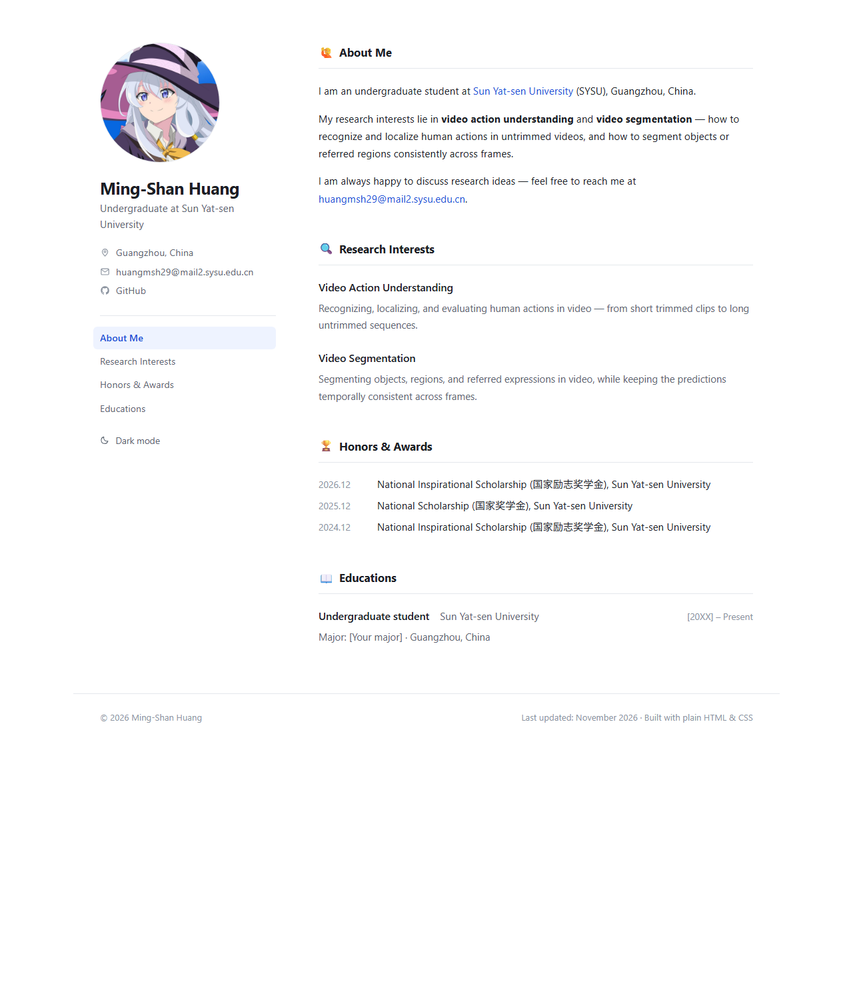

# Ming-Shan Huang · 个人主页

中山大学本科生 Ming-Shan Huang 的个人主页，已按你的信息填好内容。布局参考 [tmliang.github.io](https://tmliang.github.io/)：
左侧固定档案栏（头像 / 简介 / 联系方式 / 目录），右侧分区内容。

- 纯静态：只有一个 `index.html`，不需要 Node、Jekyll 或任何构建步骤
- 自适应桌面 / 平板 / 手机
- 自带深色模式（跟随系统，也可手动切换并记住选择）
- 目录随滚动高亮，锚点平滑滚动



---

## 1. 已填好的内容

| 项目 | 当前内容 |
| --- | --- |
| 姓名 | Ming-Shan Huang |
| 身份 | Undergraduate at Sun Yat-sen University |
| 地点 | Guangzhou, China |
| 邮箱 | huangmsh29@mail2.sysu.edu.cn |
| GitHub | <https://github.com/Felicity0710> |
| 研究方向 | Video Action Understanding / Video Segmentation |
| 获奖 | 2026.12 国家励志奖学金、2025.12 国家奖学金、2024.12 国家励志奖学金 |
| 教育 | Sun Yat-sen University，本科生在读 |
| 头像 | `images/profile.jpg`（900×900） |

因为目前没有论文、实习和审稿经历，页面**没有** Publications / Internships / Services 三个板块，避免出现空壳。等有内容了随时可以加回来（见第 5 节）。

### 还有两处需要你补上

教育经历里有两个占位符没填，因为不知道你的具体信息：

```html
<span class="entry__date">[20XX] – Present</span>   <!-- 入学年份，如 2024 -->
<p class="entry__desc">Major: [Your major] · Guangzhou, China</p>   <!-- 你的专业 -->
```

另外，获奖里的 `2026.12 国家励志奖学金` 是一个未来日期（现在是 2026 年 11 月），如果其实是 `2023.12`，改一下 `<time datetime="2026-12">` 和显示的 `2026.12` 即可。

---

## 2. 目录结构

```
homepage/
├── index.html              ← 唯一需要改的页面
├── assets/
│   ├── css/style.css       ← 配色、字体、间距
│   └── js/main.js          ← 主题切换、目录高亮、页脚年份
├── images/
│   ├── profile.jpg         ← 头像
│   └── favicon.svg         ← 浏览器标签页图标（MH）
├── preview/                ← 效果截图（可删）
├── .nojekyll               ← 让 GitHub Pages 跳过 Jekyll 处理
└── README.md
```

---

## 3. 本地预览

1. **最简单**：双击 `index.html`。
2. 或在该文件夹执行 `python -m http.server 8000`，访问 <http://localhost:8000>。
3. 或用 VS Code 的 *Live Server* 插件，改完自动刷新。

---

## 4. 发布到 GitHub Pages（约 5 分钟）

### 4.1 建仓库

1. 登录 GitHub，右上角 **+ → New repository**。
2. 仓库名填 **`Felicity0710.github.io`**（必须是 `<用户名>.github.io` 这个格式，才能用 `https://felicity0710.github.io` 直接访问）。
3. 选 **Public**，不要勾选初始化 README，Create。（`Felicity0710.github.io` 这个仓库正常情况还没建过，直接新建即可。）

### 4.2 上传文件

1. 进入仓库 → **Add file → Upload files**。
2. 把 `homepage` 文件夹**里面的内容**（`index.html`、`assets/`、`images/`、`.nojekyll`）拖进去。
   > 注意是里面的内容，不要连 `homepage` 这层文件夹一起传，否则地址会多一层 `/homepage/`。
   > `.nojekyll` 是隐藏文件，Windows 资源管理器里要先开启「显示隐藏的项目」才能看到；没有它也能正常访问，只是 GitHub 会多跑一遍 Jekyll。
3. 填提交信息 → **Commit changes**。

用 Git 命令行的话：

```bash
cd homepage
git init
git add .
git commit -m "init homepage"
git branch -M main
git remote add origin https://github.com/Felicity0710/Felicity0710.github.io.git
git push -u origin main
```

### 4.3 打开 Pages

1. 仓库 → **Settings → Pages**。
2. *Build and deployment* → **Source** 选 **Deploy from a branch**。
3. **Branch** 选 `main`，目录选 `/ (root)`，**Save**。
4. 等 1–3 分钟，顶部出现 `Your site is live at https://felicity0710.github.io/`。
5. 打开 404 的话先等几分钟；仍然不行就检查文件名是不是小写 `index.html`、是否在仓库根目录。

### 4.4 以后更新

改完文件重新上传（或 `git push`），1 分钟内自动生效。看不到变化时 `Ctrl + F5` 强刷。

---

## 5. 以后怎么加内容

### 加论文（Publications）

先在 `index.html` 里 `<!-- ---------- Research Interests ---------- -->` 这一行**上面**插入整个板块：

```html
<section class="section" id="publications">
  <h2 class="section__title"><span aria-hidden="true">📝</span> Publications</h2>

  <div class="pubs">
    <article class="pub">
      <a class="pub__thumb" href="#">
        
      </a>
      <div class="pub__body">
        <h3 class="pub__title"><a href="#">论文标题</a></h3>
        <p class="pub__authors"><strong>Ming-Shan Huang</strong>, 合作者, 导师</p>
        <p class="pub__venue"><em>CVPR</em> 2026 <span class="pub__note">(Oral)</span></p>
        <p class="pub__links">
          <a class="chip" href="#">Paper</a>
          <a class="chip" href="#">Code</a>
        </p>
      </div>
    </article>
  </div>

  <!-- 非一作 / 其他论文：纯文字列表，不需要配图 -->
  <h3 class="subhead">Other Publications</h3>
  <ul class="pub-list">
    <li>
      <strong>论文标题</strong>. 第一作者, <strong>Ming-Shan Huang</strong>.
      <em>会议/期刊</em>, 2025. <a href="#">[paper]</a>
    </li>
  </ul>
</section>
```

再把左侧目录补一行（放在 `<a href="#research">Research Interests</a>` 前面）：

```html
<a href="#publications">Publications</a>
```

CSS 已经写好了，配图建议 16:9（640×360 以上）放在 `images/`。不想要配图就删掉 `<a class="pub__thumb">…</a>` 整段，文字会自动占满整行。

### 加 News

```html
<section class="section" id="news">
  <h2 class="section__title"><span aria-hidden="true">🔥</span> News</h2>
  <ul class="news">
    <li>
      <time datetime="2026-12">2026.12</time>
      <p>Paper accepted by <em>CVPR 2026</em>.</p>
    </li>
  </ul>
</section>
```

同样记得在 `.profile__nav` 里加 `<a href="#news">News</a>`。

### 加简历（CV）

1. 把 `cv.pdf` 放进 `assets/`。
2. 在 `index.html` 的 `.profile__meta` 里找到被注释掉的 CV 那一段，删掉 `<!--` 和 `-->` 取消注释。

### 加 Google Scholar

拿到 Scholar ID 后，把 `.profile__meta` 里注释掉的 Scholar 那一段取消注释并填 ID。

### 改配色 / 字体

`assets/css/style.css` 最上面的 `:root` 就是全部颜色：

```css
--accent: #1d4ed8;   /* 链接、按钮、高亮色 */
--bg:     #ffffff;   /* 背景 */
--fg:     #1b1e23;   /* 正文 */
```

深色模式在下面的 `[data-theme="dark"]` 里改。字体在 `--font-sans`。

### 换成中文界面

把 `<html lang="en">` 改成 `<html lang="zh-CN">`，再翻译标题（About Me → 关于我、News → 最新动态、Honors & Awards → 荣誉奖项…），CSS 不用动。

---

## 6. 常见问题

**图片不显示？**
GitHub Pages 区分大小写，`images/Profile.jpg` 和 `images/profile.jpg` 是两个文件。

**改了没生效？**
等 1 分钟构建，再 `Ctrl + F5`；也可以去仓库 **Actions** 看部署状态。

**头像想换？**
直接覆盖 `images/profile.jpg`（正方形，建议 ≥600×600）。现在是插画头像，圆形裁切会切掉边缘；换成真人照片效果最好的是「脸在画面中间偏上」。

**想用自己的域名？**
仓库根目录加 `CNAME` 文件写域名，域名服务商处把 CNAME 指到 `felicity0710.github.io`，再在 Pages 里勾 *Enforce HTTPS*。

---

## 7. 关于模板来源（可选）

原站用的是 Jekyll 的 *academicpages* 主题，适合论文几十篇、需要自动归档的场景。本页是手写的单页版本：加载更快、改起来不用懂 YAML，但加论文要靠复制 HTML。等你论文多了想迁移，再换主题也不迟。
